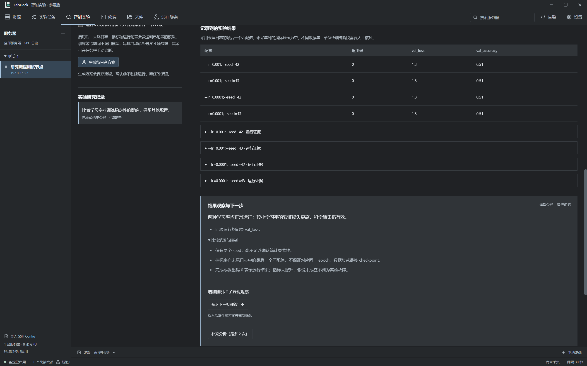

# LabDeck 智能实验工作台

基于 LabDeck / LabDock 的实验室服务器管理桌面应用，当前比赛版 **0.6.0**。将 SSH / GPU 资源管理、实验任务队列与智能诊断、修复跟踪、对照实验连接起来，用于 2026「仓颉杯」参赛原型及团队开发。

本仓库为独立比赛版，保留既有项目来源记录；Git 历史从本次源码快照开始。原项目说明见 [BASE_PROJECT_README.md](BASE_PROJECT_README.md)，快照来源及 AI 辅助开发说明见 [PROVENANCE.json](PROVENANCE.json)。




## 团队第一次启动

开发和发布以 **Windows x64 + Node.js 22 + npm + Git** 为验证环境。仓库提供已编译的仓颉参数引擎和必要 DLL，普通前端、TypeScript 开发无需先安装仓颉 SDK。当前原生引擎及集成测试面向 Windows x64，macOS / Linux 尚未完成适配与验证。

先由仓库所有者在 GitHub 的 **Settings → Collaborators** 添加成员；成员接受邀请后，用自己的 GitHub 账户克隆：

```powershell
git clone https://github.com/cz413/labdeck-competition-2026.git
cd labdeck-competition-2026
node --version
npm ci
npm run dev
```

- `npm ci` 按 `package-lock.json` 安装依赖，仓库不包含 `node_modules`。安装阶段需要访问 npm 和 Electron 下载源。
- 默认进入“实验任务”。选择“智能创建”时只需给出项目位置和实验目的，系统完成文件选择、入口识别、环境核对并生成方案卡片；熟悉配置的成员可直接“手动创建”。已保存的真实服务器 Python 命令任务可通过“创建对照组”进入对照设计与离线演示。
- 开发启动使用独立比赛版应用数据目录。如果该电脑已运行比赛版安装包，两者会读取同一比赛版数据；开发调试请使用测试服务器，或使用下文自带隔离数据的验证脚本。应用检测到默认数据目录不可写时，会自动改用仓库内的 `.labdeck-data` 并复制现有数据（包括 `safeStorage` 依赖的 `Local State`）；dev 脚本在 Chromium 沙箱初始化失败时会自动用 `--noSandbox` 重试一次。也可以手动设置绝对路径环境变量 `LABDECK_DATA_DIR`，或传入 `--labdeck-data-dir=...`。

## 已实现的主要功能

| 功能 | 实现与使用边界 |
| --- | --- |
| 服务器与资源管理 | SSH 连接、终端、SFTP、端口隧道、Conda 环境查看、GPU 状态与实验任务队列，延续原项目能力。 |
| 实验任务 | 智能创建使用独立准备视图，手动创建保留完整配置编辑器；两条路径共用任务草稿、GPU 选择与调度队列。 |
| 智能创建 | 首屏只填写项目位置与实验目的；系统自动选择相关文件、识别训练/评估入口、读取服务器环境并生成“本次实验 / 运行方式 / 环境与数据 / 输出与观察”方案卡片。支持缺口追问、自然语言修改、撤销、完整配置编辑、断点恢复和分析时间线，详见 [操作流程](docs/TASK-CREATION.md)。 |
| 故障诊断（历史能力） | 底层规则、分析和报告接口保留；本轮移除独立智能实验页面，暂不设计诊断入口。 |
| 修复闭环（历史能力） | 原服务和历史记录保留，当前页面调整未重做此流程。 |
| 对照实验 | 手工或 AI 建议参数轴；仓颉展开组合、去重和检查预算；LangGraph 编排审查、入队、等待、采集、诊断和分析，支持磁盘检查点恢复。 |
| 结果记录与比较 | 采集指定 metrics.json 及产物元信息，记录指标来源和口径；未指定时提取日志末值。进程状态、证据完整度和研究观察分开展示，支持重新采集。指标未提升仍是有效实验观察，不自动当成运行故障。 |
| 对照演示 | 从任务详情进入对照设计，展开“离线演示”；模拟结果不写入真实任务历史。 |

当前没有实现 GPU 显存需求预测、通用模型产物解析或多人共享服务端。团队通过 GitHub 协作开发，但运行时的服务器配置、模型设置和实验记录仍保存在各自电脑。

## 配置真实服务器和模型

### 服务器

在应用内添加 SSH 服务器，确认主机指纹和访问方式；在实验任务中填写远程代码目录、训练命令、Conda 环境和 GPU 条件。训练代码、数据集和 Python 依赖需要已经存在于目标服务器。桌面应用本身不需要本地 CUDA。

请先用测试任务验证连接、日志、退出码和排队流程，再接入团队正式实验。对照实验中的每个配置会建立新任务并进入现有调度队列，原任务与旧运行记录保留。

### 大模型

进入 **设置 → 模型服务**，填写基础地址、模型 ID 和 API Key，启用后保存并测试。配置从应用界面填写，不需要创建 `.env`。

| 字段 | 填写方式 |
| --- | --- |
| API 基础地址 | 填服务商提供的 Chat Completions API 根地址；例如服务商根路径为 `https://your-provider.example/v1`，则填写该根路径。程序自动追加 `/chat/completions`，不要重复填写完整调用路径。 |
| 模型名称 | 填服务商实际提供的模型 ID，按照服务商控制台或官方文档核对。 |
| API Key | 每位成员使用自己的密钥，在应用界面保存；切换服务商时同步更新密钥。 |

支持兼容 Chat Completions 的返回结构，并校验模型生成的 JSON。远程基础地址要求 HTTPS，本机模拟服务允许 loopback HTTP。API Key 通过 Electron `safeStorage` 加密保存，渲染界面只获得是否已配置的状态。

模型不可用时，规则诊断和离线演示仍可使用；AI 计划、参数建议和 AI 分析需要有效模型配置。真实日志的相关内容可能作为请求输入发送给选定服务商，使用前确认日志中没有需要保密的数据。

## 日常命令

在项目根目录执行：

| 命令 | 用途与前置条件 |
| --- | --- |
| `npm ci` | 根据锁文件安装依赖；克隆后或锁文件更新后执行。 |
| `npm run dev` | 启动 Electron 开发模式；自动清除继承的 `ELECTRON_RUN_AS_NODE`，数据目录不可写时自动改用工作区 `.labdeck-data`，Chromium 沙箱初始化失败时自动用 `--noSandbox` 重试一次。 |
| `npm run dev:nosandbox` | 仅在当前环境禁止 Chromium 沙箱、`npm run dev` 在窗口初始化阶段退出时使用。 |
| `npm run typecheck` | 检查 main / preload / shared 和 renderer 的 TypeScript 类型。 |
| `npm test` | 运行 Vitest，包括实际仓颉二进制的集成测试；需要 Windows x64 及 `resources/cangjie` 完整。 |
| `npm run build` | 类型检查并生成生产构建，输出到 `out/`。 |
| `npm run preview` | 预览已构建应用，先执行 `npm run build`。 |
| `npm run verify:intelligence` | 针对旧独立诊断页面的历史联调脚本，当前入口已撤下。 |
| `npm run verify:closure` | 确认修复、自动跟踪、退出码核验、失败再诊断及恢复的 Electron 联调。 |
| `npm run verify:workflow` | 针对旧智能实验页面的历史联调脚本，当前入口已撤下。 |
| `node scripts/run-electron-check.cjs scripts/verify-research.cjs --no-sandbox` | 任务内对照方案、参数展开、确认入队和结果比较的 Electron 联调。 |
| `npm run dist:competition` | 构建 Windows 便携版，输出到 `release/`。 |
| `npm run dist` | 构建 Windows NSIS 安装包和便携版，输出到 `release/`。 |
| `npm run verify:smart-create` | 智能创建准备视图的 Electron 联调：首屏输入、方案卡片、缺口追问、修改与保存、真实图检查点重启、暂停继续和分析时间线。使用隔离模型/SSH 夹具。 |
| `npm run verify:task-creation` | 手动创建、完整配置编辑、排队任务新配置与任务内对照入口的 Electron 回归联调。 |
| `npm run verify:repository` | 指向智能创建联调（历史命令名保留）。 |
| `npm run verify:cangjie` | 严格验证原生仓颉，缺失或启动失败均报错，不能以 TypeScript 回退通过。 |
| `npm run verify:research:package` | 检查已打包程序里的 LangGraph、仓颉引擎及文件一致性，先执行 `npm run dist` 或 `npm run dist:competition`。 |

当前任务创建与对照实验的 Electron 验证使用 `out/`，先运行 `npm run build`，两个页面脚本分别运行。它们使用隔离数据目录及模拟模型 / SSH，截图和机器报告保存在 `artifacts/`，对照流程还更新 `docs/screenshots/`。

本轮源码检查为 40 个测试文件、377 项通过，类型检查和源码构建通过。智能创建接入真实 LangGraph 持久化流程，支持准备记录恢复和本地分析时间线；相关 Electron 联调使用模拟模型/SSH。未连接真实训练服务器或模型，本轮没有打包，见 [验证记录](docs/VALIDATION.md)。建议提交前执行：

```powershell
npm run typecheck
npm test
npm run build
```

涉及智能实验交互、IPC 或队列流程时，再执行对应的 Electron 验证。修改发布配置、原生组件或仓颉代码时，需要重新打包并执行发布包验证。真实模型质量、GPU 调度和训练效果须另在实际环境验证，不能由模拟联调结果推断。

## 代码结构与修改入口

```text
src/
  main/                  Electron 主进程：SSH、调度、智能服务、持久化与 IPC
  preload/               向渲染进程暴露受控接口
  shared/                类型、Schema、规则、参数算法和演示状态
  renderer/src/          React 页面与样式
cangjie/parameter-engine/ 仓颉参数组合 CLI 源码
resources/cangjie/       Windows x64 已编译引擎、运行 DLL 和第三方许可
scripts/                 构建与 Electron 联调脚本
build/                   安装包脚本
docs/                   架构、设计、演示、验证记录、截图与项目文档
```

| 想修改什么 | 优先阅读 / 修改 |
| --- | --- |
| 应用启动与 IPC 注册 | [`src/main/index.ts`](src/main/index.ts)、[`src/preload/index.ts`](src/preload/index.ts) |
| 实验任务栏和运行调度 | [`ExperimentTaskPool.tsx`](src/renderer/src/components/ExperimentTaskPool.tsx)、[`experiment-scheduler.ts`](src/main/experiment-scheduler.ts)、[`experiment-workflow.ts`](src/shared/experiment-workflow.ts) |
| 任务内项目创建、全局模型设置 | [`SmartCreatePage.tsx`](src/renderer/src/components/SmartCreatePage.tsx)、[`experiment-plan.ts`](src/shared/experiment-plan.ts)、[`ExperimentTaskPool.tsx`](src/renderer/src/components/ExperimentTaskPool.tsx)、[`ModelSettingsPanel.tsx`](src/renderer/src/components/ModelSettingsPanel.tsx) |
| 规则诊断、模型协议与只读工具 | [`diagnosis-engine.ts`](src/shared/diagnosis-engine.ts)、[`model-provider.ts`](src/main/model-provider.ts)、[`diagnostic-agent.ts`](src/main/diagnostic-agent.ts)、[`diagnostic-tools.ts`](src/main/diagnostic-tools.ts) |
| 修复后的自动跟踪 | [`repair-tracker.ts`](src/main/repair-tracker.ts)、[`RepairClosurePanel.tsx`](src/renderer/src/components/RepairClosurePanel.tsx) |
| 持久化智能创建 | [`preparation-service.ts`](src/main/preparation-service.ts)、[`SmartCreatePage.tsx`](src/renderer/src/components/SmartCreatePage.tsx)、[`PreparationTimeline.tsx`](src/renderer/src/components/PreparationTimeline.tsx) |
| 对照实验和 LangGraph | [`research-service.ts`](src/main/research-service.ts)、[`research-checkpointer.ts`](src/main/research-checkpointer.ts)、[`ResearchPage.tsx`](src/renderer/src/components/ResearchPage.tsx)、[`research.ts`](src/shared/research.ts) |
| 仓颉参数引擎和回退实现 | [`main.cj`](cangjie/parameter-engine/main.cj)、[`parameter-bridge.ts`](src/main/parameter-bridge.ts)、[`parameter-engine.ts`](src/shared/parameter-engine.ts) |
| 应用存储与迁移 | [`store.ts`](src/main/store.ts)；改动时关注历史配置与实验运行的兼容性。 |
| 对照演示 | 从任务详情进入对照设计，展开“离线演示”；模拟结果不写入真实任务历史。 |
| 测试 | 与服务同目录的 `*.test.ts` 和 `scripts/verify-*.cjs`。 |

通常按 **shared 类型 / Schema → main 服务 → preload 接口 → renderer 页面** 的顺序实现跨进程功能。渲染进程不得直接执行 SSH、访问模型密钥或绕过主进程启动远程任务。

### 工作流设计约束

1. **审查后执行**：计划保存草稿、修复建立新运行、对照实验批量入队都有明确人工确认入口。
2. **诊断工具只读且有预算**：最多 4 轮模型请求、4 项检查，每轮最多 2 项；模型可提前结束，不能生成任意 Shell 工具。
3. **进程结束与科研结果分开**：退出码 0 表示命令正常结束；accuracy / loss 未达到预期，不等于程序故障。
4. **检查点与去重**：对照实验通过 LangGraph 和磁盘检查点恢复，继续执行时应保留成员标记，避免重复创建或启动任务。
5. **沿用原调度器**：智能实验进入已有任务队列，不另开一套 AI 执行路径。
6. **演示与真实任务隔离**：模拟记录标明来源，不写入正式任务、报告和模型设置；不能把模拟指标作为真实实验结论。

当前自动修复只支持实际失败运行中的明确 CUDA OOM，以及无引号、无 Shell 组合的简单 Python 命令里的 `--batch-size` / `--batch_size`。修复通过减半参数创建新运行，不修改原脚本。依赖缺失、路径错误、复杂命令等情况提供诊断建议。

跟踪器通常每 30 秒观察运行；结束时才重新读取远程退出码。证据不完整时显示待确认并有限重查。应用运行或留在托盘时才进行本地跟踪，退出或电脑休眠期间不会持续观察；暂停跟踪不取消远程实验。

## 修改仓颉模块

仓颉模块负责组合展开、去重、预算约束和命令生成，主进程通过子进程协议调用。可用状态和实际执行引擎会反映在预览结果中；引擎缺失或启动自检失败时显式提示 TypeScript 回退及原因，不能将回退结果声称为仓颉执行。自检通过后实际请求若执行或协议校验失败，则阻止该次生成。重新编译后重启应用，以重新检查启动状态。

要修改 `.cj`，安装 **仓颉 1.0.5 Windows x64 SDK**，找到包含 `envsetup.ps1` 的 SDK 根目录后执行：

```powershell
powershell -NoProfile -ExecutionPolicy Bypass -File .\scripts\build-cangjie.ps1 -SdkRoot "C:\tools\cangjie"
npm test
npm run build
npm run verify:research
npm run dist:competition
npm run verify:research:package
```

构建脚本重新生成 `resources/cangjie/parameter-engine.exe`，复制 SDK 的运行 DLL、许可和第三方声明。默认 SDK 路径为 `artifacts/cangjie-sdk/cangjie`；使用其他位置时需传 `-SdkRoot`。SDK 本体不纳入 Git。

仓库继续使用配套的 1.0.5 EXE/DLL，并包含官方 Windows loader 修复 #920 的本地未签名兼容回移。构建脚本严格核对原运行时 SHA256，执行回移后先做脱离 SDK 的原生自检，再替换项目组件；未知版本会拒绝处理。原生展开、去重、预算拒绝和实际桥接测试已在本机通过。详见 [Windows 运行时修复](docs/CANGJIE-WINDOWS-FIX.md)。

修改仓颉源代码时，应提交对应的新引擎与必要运行组件，并在 PR 中说明 SDK 版本和验证结果。不要提交编译中间文件 `*.cjo`。

## 数据、密钥和 Git 忽略范围

| 内容 | 位置 / 管理方式 |
| --- | --- |
| 比赛版桌面应用数据 | `%APPDATA%\LabDeck-Competition-2026`，每台电脑各自保存。 |
| 远程运行记录 | `$HOME/.local/state/labdeck-competition/runs`，与原版运行目录分开。 |
| UI 验证数据和仓颉 SDK | `artifacts/`，不提交。 |
| npm 依赖 / 构建 / 安装包 | `node_modules/`、`out/`、`release/`、`dist/`，不提交。 |
| 临时输出与本机核对记录 | `tmp/`、`output/`、`isolation-verification.json`，不提交。 |
| 环境与连接秘密 | `.env*`、`config.local.*`、私钥文件和日志不提交；不要在源码或提交描述中填写真实 API Key / 密码。 |
| 可共享项目材料 | `docs/`、脱敏演示截图与项目说明文档。 |

自动脱敏和 `.gitignore` 不能替代提交审查。提交前检查 `git diff --cached`，尤其是新日志、截图和导出报告。不要上传本机应用数据目录，也不要复制其他成员的加密设置文件作为配置模板。

## 团队协作

详细约定见 [CONTRIBUTING.md](CONTRIBUTING.md)。建议每个功能使用独立分支，通过 PR 合并到 `main`，不要共享账户和密钥。

```powershell
git switch main
git pull --ff-only
git switch -c codex/your-feature
# 完成开发并通过适用检查后：
git add <本次修改的文件>
git commit -m "Describe the change"
git push -u origin codex/your-feature
```

PR 写清楚解决的问题、影响的任务 / 智能流程、验证命令与结果。修改持久化结构时，补充旧数据兼容策略；修改 IPC 时同步类型和 preload；涉及仓颉时同步源代码与运行组件。新增 npm 依赖时提交 `package.json` 和 `package-lock.json`，并说明用途。

报告问题时提供系统架构、Node / 应用版本、复现步骤、预期和实际行为，以及脱敏日志；区分离线演示、模拟联调和真实服务器问题。

## 常见问题

| 现象 | 排查方式 |
| --- | --- |
| 克隆提示找不到仓库 | 仓库为私密；确认已接受协作邀请，Git 凭据使用获授权的 GitHub 账户。 |
| PowerShell 拒绝运行 `npm.ps1` | 可使用 `npm.cmd ci`、`npm.cmd run dev` 等对应命令，无需为此更改系统执行策略。 |
| 安装或 Electron 下载失败 | 检查网络、代理与下载源，重试 `npm ci`；不要提交机器上的代理凭据。 |
| 原生模块加载失败 | 确认 Windows x64 和 Node 22，先重新 `npm ci`；如修改过原生依赖，检查其构建要求及 Electron 兼容性，并验证终端与打包后的程序。 |
| 仓颉集成测试失败 / 提示回退 | 确认 `resources/cangjie` 的 EXE 和 DLL 完整，未被安全软件隔离，并在 Windows x64 环境运行。修改源码后需重新编译。 |
| Electron 验证找不到构建文件 | 先执行 `npm run build`；发布包验证还需先打包生成 `release/win-unpacked`。 |
| 模型返回 401 / 404 / 非 JSON | 核对基础地址、模型 ID、密钥和账户额度；基础地址后不应重复 `/chat/completions`。 |
| 启动实验时提示 EPERM / 无法写入 AppData | 应用运行在只读沙箱或受限账户中。用 `npm run dev` 启动时会自动切换到仓库内 `.labdeck-data`；打包程序请改在普通桌面终端启动，或手动设置 `LABDECK_DATA_DIR` 到可写目录。 |
| 提示 safeStorage / 凭据解密失败 | 切换数据目录时缺少 `Local State`（Windows 上 safeStorage 的密钥文件）。退出应用后删除 `.labdeck-data`，下次启动会自动连同 `Local State` 重新复制；仍失败则在模型设置里重新填写 API Key。 |
| 分析仓库时 `fetch failed` / `ECONNRESET` | 请求体过大被服务端断开（例如 98 MB）。默认单次约 30 万字符，超出会跳过；可取消大文件、选择更具体的子目录，或用 `LABDECK_REPO_MAX_CHARS` 调整上限（需重启应用）。 |
| 实验一直排队 | 检查服务器在线状态、任务指定 GPU、可用显存、并发条件和远程环境；离线演示不是实际队列。 |
| 修复后显示待确认 | 应用尚未取得可靠退出码或远程连接失败；查看证据，再手动核验或继续跟踪，不要仅凭指标推断进程正常。 |

`scripts/` 还保留一些原项目的专项验证工具，其中部分带有本机安装路径假设。日常团队开发优先使用上面列出的 npm 脚本，使用其他历史工具前先阅读脚本内容。

## 项目文档与来源

- [团队贡献指南](CONTRIBUTING.md)
- [架构说明](docs/ARCHITECTURE.md)
- [故障修复闭环设计](docs/CLOSURE-DESIGN.md)
- [任务与智能实验联动设计](docs/WORKFLOW-DESIGN.md)
- [对照实验与 LangGraph 设计](docs/RESEARCH-DESIGN.md)
- [基础演示步骤](docs/DEMO-GUIDE.md) / [对照实验使用指南](docs/RESEARCH-GUIDE.md)
- [结构化结果采集与训练脚本输出协议](docs/RESULTS-GUIDE.md)
- [验证记录及其实际范围](docs/VALIDATION.md)
- [项目说明文档 0.5.0（Word）](docs/project/LabDeck智能实验工作台项目文档0.5.0.docx)
- [版本功能记录](docs/CHANGELOG.md) / [后续路线](docs/ROADMAP.md)
- [既有项目说明](BASE_PROJECT_README.md) / [来源与 AI 辅助开发记录](PROVENANCE.json)

`package.json` 沿用既有项目的 MIT 声明。本仓库同时包含第三方组件，仓颉运行组件的许可与声明保存在 [CANGJIE-LICENSE](resources/cangjie/CANGJIE-LICENSE) 和 [Open_Source_Software_Notice.docx](resources/cangjie/Open_Source_Software_Notice.docx)。参赛和对外发布时应如实说明既有代码基础、新增模块及 AI 辅助开发范围，并保留适用的第三方声明。

### 从项目创建实验

进入“实验任务 → 从项目创建”，选择服务器、填写目标和项目根目录，查看文件范围，再生成配置建议。审阅后应用到当前草稿，继续手动补充；保存草稿不会启动运行。“保存并选择资源”进入 GPU 配置，最终确认后才入队。

已保存任务的“完善配置”复用同一编辑器；“创建对照组”进入任务内的参数设计与结果比较。模型连接统一在“设置 → 模型服务”配置。完整交互、草稿保存边界和源码验证命令见 [任务创建流程](docs/TASK-CREATION.md)。

本轮撤下独立的“智能实验”导航，原计划、仓库编排、诊断及闭环服务保留兼容，不作为当前新建实验的前置步骤。


## 作品演示视频素材

参见 [视频制作说明](docs/demo-video/制作说明.md) 和 [离线分镜预览](docs/demo-video/分镜预览.html)。素材包含 6 张参考 PNG、可编辑 SVG、5 段镜头提示词、旁白定位和约 6 分钟的剪辑时间线；其中动画共 53 秒。这是制作素材，尚未生成连续动画或最终视频。
