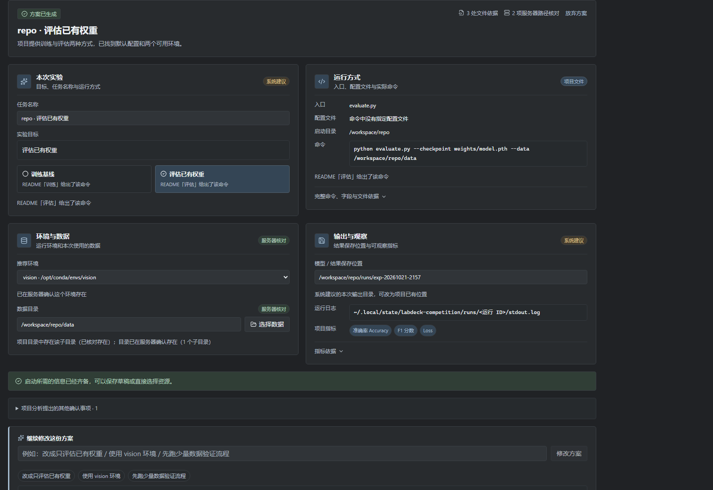
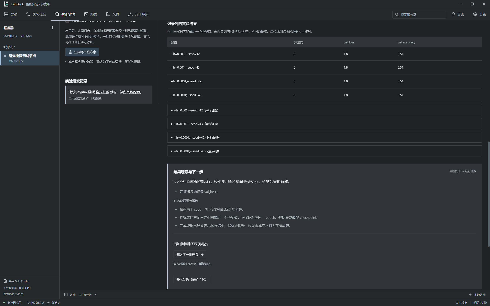
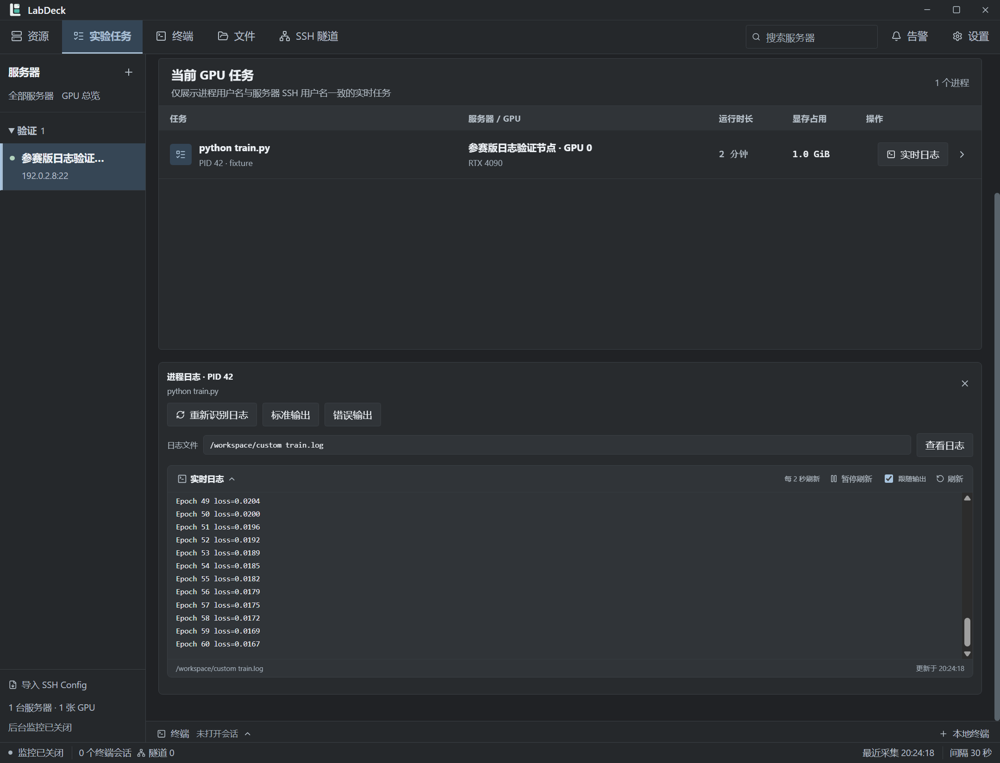

# LabDeck 智能实验工作台

LabDeck 是面向远程 Linux 实验服务器的 Windows 桌面应用，将服务器连接、CPU/GPU 资源监控、实验准备、任务调度、日志查看与对照结果集中到一个工作台中。

通过 SSH 连接已有服务器，无需额外部署业务后端。实验代码、数据集与训练进程保留在服务器上，桌面端负责配置、编排、观察和记录。

当前版本：**0.6.0** · 已验证平台：**Windows x64** · 2026「仓颉杯」参赛作品

## 功能概览

| 功能 | 说明 |
| --- | --- |
| 服务器与资源管理 | SSH 连接、CPU/GPU 状态与进程监控、远程终端、SFTP 文件管理、端口隧道和 Conda 环境查看。 |
| 智能实验准备 | 根据项目位置和目标分析入口、环境及数据候选，生成可编辑方案；支持自然语言修订、只读核对、准备记录保存与恢复。 |
| 实验任务与调度 | 手动或智能创建任务，选择 CPU/GPU 执行；保存配置与启动分别确认，每次运行保留独立记录和配置快照。 |
| 实时与历史日志 | 从任务详情、运行记录和 GPU 进程查看日志，支持自动识别来源、手动指定文件、暂停刷新和跟随输出。 |
| 任务诊断 | 从失败运行进入原因分析，结合日志、退出状态与资源证据给出诊断和修复候选，确认后创建新运行。 |
| 对照实验 | 设计参数轴与成员配置，由仓颉引擎展开组合、去重并检查预算；审查后执行，使用 LangGraph 保存检查点。 |
| 结果采集与比较 | 为成员运行选择结果文件，采集指标与产物信息，比较参数和结果，保留指标来源及证据口径。 |

### 界面预览

**智能实验准备**



**对照实验结果**



截图用于展示界面，其中演示或隔离验证数据不代表真实训练效果。

## 安装与启动

### 使用 Windows 安装包

获取项目提供的 `LabDeck Competition Setup <版本号>.exe` 后，双击安装，选择安装范围与目录，完成后从桌面快捷方式或开始菜单启动 **LabDeck Competition**。

覆盖安装前，请完全退出旧版，包括系统托盘中的程序。若提示无法写入旧的卸载程序，请中止安装，关闭相关程序或重启电脑后重试。

安装包包含 Electron 运行环境、仓颉参数引擎和必要运行库，正常使用无需另行安装 Node.js、仓颉 SDK 或本地 CUDA。

### 从源码运行

开发环境使用 **Windows x64、Node.js 22 和 npm**。macOS / Linux 桌面端尚未完成适配与验证。

```powershell
git clone https://github.com/cz413/labdeck-competition-2026.git
cd labdeck-competition-2026
npm ci
npm run dev
```

`npm ci` 按锁文件安装依赖，需要访问 npm 与 Electron 下载源。若 PowerShell 阻止执行 `npm.ps1`，可使用对应的 `npm.cmd` 命令。

## 快速上手

### 1. 连接实验服务器

在应用中添加 SSH 服务器，填写主机、端口、账号和认证方式，确认主机指纹并连接。训练代码、数据集及 Python / Conda 依赖需在服务器上准备好。

连接后可查看资源状态、打开终端或浏览项目文件。远程操作使用所配置账号的访问权限。

### 2. 配置模型服务

需要智能准备、模型诊断或 AI 分析时，进入 **设置 → 模型服务**，启用并填写以下内容：

| 配置项 | 说明 |
| --- | --- |
| API 基础地址 | 兼容 Chat Completions 的 API 根地址，例如 `https://your-provider.example/v1`。程序自动追加 `/chat/completions`。 |
| 模型名称 | 服务商提供的实际模型 ID。 |
| API Key | 对应服务的密钥，在应用内填写和保存。 |

远程端点使用 HTTPS，本机 loopback 服务可使用 HTTP。密钥通过 Electron `safeStorage` 加密保存，无需创建 `.env`。

模型是可配置的外部服务，安装包不包含模型权重。选定的项目文本、日志或实验上下文可能发送到该服务，请按数据使用要求选择阅读范围与服务商。未配置模型时，仍可手动创建任务、连接服务器和查看资源与日志。

### 3. 创建并运行实验

- **智能创建**：在“实验任务”中选择“智能创建”，填写项目位置和目标，审阅生成的方案并补充配置，保存后选择资源并确认启动。
- **手动创建**：直接填写远程代码目录、命令或脚本、环境和数据路径，再选择 CPU 或 GPU 执行。
- **运行记录**：保存任务不会启动训练；启动后生成独立运行记录，可查看排队原因、状态、日志与历史配置。

CPU 路径跳过 GPU 等待，但脚本仍须支持 CPU 执行。GPU 路径根据指定设备或自动选择条件检查资源；目录、环境或资源未就绪时保留等待原因。

### 4. 查看日志与诊断

打开任务详情查看运行日志，展开运行记录可查看指定运行的日志。对于在服务器上自行启动的 GPU 任务，可在 **GPU 实时进程** 或 GPU 详情的进程列表中打开“实时日志”。

日志默认每 2 秒刷新，读取末尾最多 64 KiB 并展示最近 300 行。未识别到来源时可填写日志文件的绝对路径。仅输出到终端或管道、没有落盘的历史内容无法补读。页面隐藏、关闭面板或检测到进程身份变化时停止相关读取。

失败运行可通过“分析原因”查看诊断。修复建议需确认后应用；当前自动修复范围限于明确 CUDA OOM 下简单 Python 命令的批大小调整，复杂命令或其他故障提供分析建议。



### 5. 设计对照实验

从已保存的任务进入“创建对照组”，设置参数轴、成员配置和运行预算。核对展开结果与顺序后确认运行，再为成员选择指标或结果文件，查看对照结果及来源证据。

退出码为 0 仅表示命令正常结束；指标未提升属于实验观察，不自动判定为程序故障。缺失指标或文件会显示证据问题，不补成零。离线演示使用模拟数据，不写入真实任务历史。

## 数据与运行边界

- **本地记录**：默认保存在 `%APPDATA%\LabDeck-Competition-2026`。开发版和安装版默认共用该目录。
- **隔离数据**：可将 `LABDECK_DATA_DIR` 设置为可写的绝对路径，或传入 `--labdeck-data-dir=...`。开发模式支持在默认目录不可写时回退到工作区 `.labdeck-data`。
- **远程文件**：代码、数据、日志和产物保留在服务器，默认运行目录为 `$HOME/.local/state/labdeck-competition/runs`。
- **持续观察**：应用运行或留在托盘时进行本地跟踪，退出或电脑休眠后不会持续采集。暂停本地跟踪不等于暂停远程训练。
- **使用范围**：当前为本地桌面工作台，未提供多人共享服务端、GPU 显存需求预测或通用模型产物解析。

## 构建与验证

在仓库根目录执行：

| 命令 | 用途 |
| --- | --- |
| `npm run typecheck` | 检查主进程、共享契约与界面类型。 |
| `npm test` | 运行自动化测试，包含 Windows x64 仓颉原生集成测试。 |
| `npm run build` | 检查类型并构建到 `out/`。 |
| `npm run preview` | 启动已构建的应用。 |
| `npm run dist` | 生成 Windows NSIS 安装包和便携版，输出到 `release/`。 |
| `npm run dist:competition` | 生成 Windows 便携版。 |
| `npm run verify:cangjie` | 严格验证仓颉原生引擎。 |
| `npm run verify:research:package` | 检查发布包内的依赖、仓颉引擎与构建文件一致性。 |

智能创建和任务创建的界面验证分别使用 `npm run verify:smart-create`、`npm run verify:task-creation`，先执行 `npm run build`。日志界面验证可运行：

```powershell
node scripts/run-electron-check.cjs scripts/verify-process-logs.cjs --no-sandbox
```

界面验证使用隔离数据及模拟模型 / SSH，不能替代真实服务器、模型服务和训练效果的验收。验证范围见 [验证记录](docs/VALIDATION.md)。

### 仓颉参数引擎

仓颉负责组合展开、去重、预算约束与命令生成，通过本地子进程与主进程通信。仓库附带 Windows x64 编译产物，普通运行和 TypeScript 开发无需安装仓颉 SDK。

修改仓颉源码时，使用 **仓颉 1.0.5 Windows x64 SDK** 重新构建：

```powershell
powershell -NoProfile -ExecutionPolicy Bypass -File .\scripts\build-cangjie.ps1 -SdkRoot "C:\tools\cangjie"
npm run verify:cangjie
npm test
```

引擎缺失或启动自检失败时，界面明确标注 TypeScript 回退及原因；自检通过后实际执行或协议校验失败，则阻止本次生成。运行组件与兼容修复见 [仓颉 Windows 运行时说明](docs/CANGJIE-WINDOWS-FIX.md)。

## 项目结构

```text
src/
  main/                    SSH、调度、智能服务、持久化与 IPC
  preload/                 向界面暴露受控接口
  shared/                  类型、校验规则、参数算法与演示状态
  renderer/src/            React 页面与样式
cangjie/parameter-engine/  仓颉参数引擎源码
resources/cangjie/         已编译引擎、运行库和第三方声明
scripts/                   构建与验证脚本
build/                     安装程序配置
docs/                      使用指南、设计说明与截图
```

主要技术：Electron、React、TypeScript、Node.js、SSH/SFTP、xterm.js、ECharts、LangGraph、Zod 与仓颉。

## 常见问题

| 问题 | 处理方式 |
| --- | --- |
| 安装时无法写入卸载程序 | 退出旧版及托盘进程，中止安装后重试；必要时重启电脑再安装。 |
| 实验一直排队 | 查看等待原因，核对连接、目录、环境及 GPU 选择条件。 |
| 日志为空或无法读取 | 确认程序已输出、日志已落盘，当前 SSH 账号有读取权限；必要时手动指定文件。 |
| 模型返回 401、404 或非 JSON | 核对根地址、模型 ID、密钥与额度，不要重复填写 `/chat/completions`。 |
| 仓颉启动失败或提示回退 | 确认 Windows x64，且 `resources/cangjie` 内的 EXE 与 DLL 完整。 |
| 应用数据目录不可写 | 设置 `LABDECK_DATA_DIR` 为可写的绝对路径。 |
| 密钥无法解密 | 在原系统账号下使用原数据目录；迁移或更换系统后可重新填写凭据与模型密钥。 |

反馈问题时，请提供应用版本、系统信息、复现步骤和脱敏日志，并注明使用真实服务器还是离线演示。请勿在 Issue、截图或提交中包含密码、私钥和 API Key。

## 文档与贡献

- [任务创建流程](docs/TASK-CREATION.md)
- [对照实验使用指南](docs/RESEARCH-GUIDE.md)
- [结果文件与指标采集协议](docs/RESULTS-GUIDE.md)
- [系统架构](docs/ARCHITECTURE.md)
- [对照实验与 LangGraph 设计](docs/RESEARCH-DESIGN.md)
- [版本记录](docs/CHANGELOG.md)
- [贡献指南](CONTRIBUTING.md)

部分设计文档保留早期版本的导航名称，实际入口以当前应用为准。

## 来源与第三方声明

项目 `package.json` 声明为 MIT，第三方组件遵循各自许可。仓颉运行组件的声明见 [CANGJIE-LICENSE](resources/cangjie/CANGJIE-LICENSE) 与 [Open Source Software Notice](resources/cangjie/Open_Source_Software_Notice.docx)。
