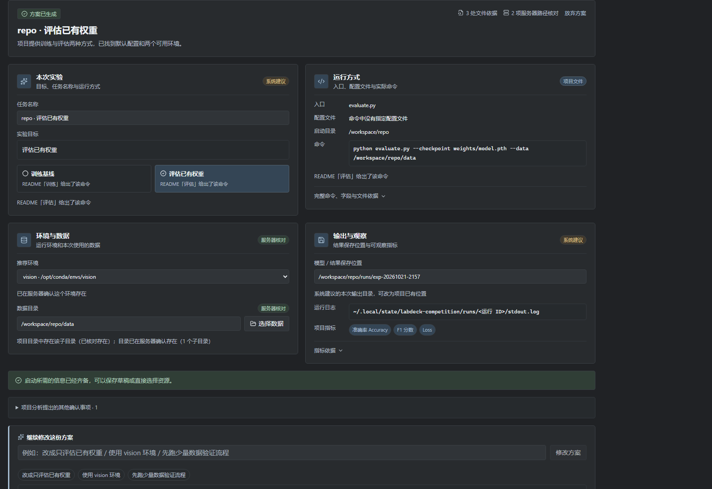

# 实验任务内的智能创建与详细编辑

本轮把项目理解从“手动推进的机械步骤”改为一条智能准备路径：用户只说明项目位置和实验目的，系统连续完成文件选择、入口识别、环境核对和方案生成；生成的方案直接就是当前草稿，保存时才创建任务。手动创建作为详细编辑能力保留，两者共用任务数据、GPU 选择与调度队列。



## 操作路径

### 智能创建

1. 打开“实验任务”，点击“智能创建”，进入独立的实验准备视图。
2. 首屏只填写两项：**项目位置**（服务器、连接路径、目录；支持最近项目、浏览和扫描）和**想做什么**（例如“先跑一次基线”“评估已有权重”“复现 README 的训练配置”）。此时不展示任务名称、启动命令、Conda、数据目录等整套表单。
3. 点击“分析项目并准备实验”。系统依次：
   - 读取项目文件清单，默认选中 README、依赖说明、训练/评估入口与配置文件；“分析范围”可展开调整，并可按新范围重新分析；
   - 报告已经理解的内容，例如找到训练与评估入口、默认配置、可用 Conda 环境；
   - 只读分析项目内容并生成最小运行方案，过程中最多四次模型请求，可随时取消。
4. 结果以四张卡片呈现：
   - **本次实验**：实验目标、自动建议的任务名称、训练基线 / 评估已有权重（多入口时给出推荐与理由）；
   - **运行方式**：入口、配置文件、启动目录、命令及选择理由，完整命令和行号依据可展开；
   - **环境与数据**：推荐环境、识别到的数据位置、仍需补充的内容；
   - **输出与观察**：模型/结果保存位置、LabDeck 运行日志位置、项目文件中明确出现的指标。
5. 每张卡片用来源标签区分：**项目文件**、**服务器核对**、**系统建议**、**最近使用**、**你的修改**。
6. 真正缺少的信息集中询问，一次一个问题。例如确定入口和环境后仅缺数据时，只问“这次实验使用哪份数据？”，提供已发现目录、浏览其他目录、暂后补充三个选择；选择后同步调整命令中的数据参数并说明变化。
7. 方案下方的输入框支持围绕方案继续修改，例如“改成只评估已有权重”“使用 vision 环境”“先跑少量数据验证流程”。每次只更新相关字段，展示变更摘要；可撤销上次修改或恢复初始方案。手动修改过的字段会保留，若后续修改与其冲突，会明确让用户选择采用哪个值。
8. 需要精细调整时展开“编辑完整配置”。完整配置返回方案后，仍可继续用系统检查与修改；方案底部的“重新核对路径”会只读检查启动目录、入口文件和数据目录，并在界面中列出结果。
9. 最后点击“保存草稿”创建/更新任务，或“创建并选择资源”保存后直接打开既有 GPU 选择弹窗；GPU 与最终排队确认沿用现有流程。

### 手动创建

熟悉配置的成员可直接“手动创建”，在完整配置编辑器中填写任务名称、服务器、代码与数据目录、命令、Conda 环境、资源偏好等。保存草稿、创建并选择资源以及排队确认与智能创建一致。对排队、准备或运行中的任务使用“完善配置”，会创建一份新的待开始配置，保留原任务及其运行快照。

## 保存与边界

- 分析和方案生成都不创建任务；只有“保存草稿”或“创建并选择资源”才写入任务。
- 智能创建只读取项目文件清单、已选文本和环境列表，不安装依赖、不下载数据、不运行命令。
- 文件行号依据、路径核对、其他确认事项随任务保存，默认折叠显示。修改相关配置后会提示原核对已过期；运行时仍由既有执行服务检查目录、脚本与环境。
- 未保存的分析与方案只保留在当前窗口内存。切换到设置再返回会保留；离开实验准备或关闭应用会丢弃。
- 模型配置位于“设置 → 模型服务”。模型未启用时仍可使用“手动创建”。
- “最近项目”来自本机已保存任务的代码目录，不上传服务器信息。
- 从任务详情“创建对照组”进入参数设计、预算审查与结果比较。返回任务后可查看关联批次和结果。

## 源码验证

```powershell
npm run typecheck
npm test
npm run build
npm run verify:smart-create
npm run verify:task-creation
node scripts/run-electron-check.cjs scripts/verify-research.cjs --no-sandbox
```

`build` 只构建可运行源码输出，不产生安装包。Electron 联调脚本使用隔离数据与模拟模型/SSH；真实服务连通、模型建议质量和训练效果需要另在实际环境测试。纯函数测试覆盖方案生成、缺口追问、模式切换、增量修改、撤销与来源标记；`SmartCreatePage.test.tsx` 检查首屏只包含项目位置与实验目的。`verify:repository` 现指向智能创建联调，旧的 `verify:intelligence`、`verify:workflow` 针对已撤下的页面入口，保留作历史参考。
